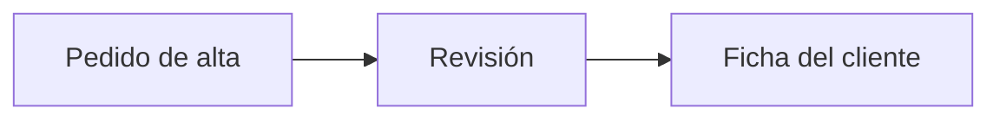

# Estado al 3 de marzo

1. La última restauración de prueba fue en octubre.
2. El cliente «Ejemplo Sur» está guardado en `varios/sur`, fuera de su carpeta.
3. «Ejemplo Norte» ya tiene su ficha.

> Nota del equipo: mudar «Ejemplo Sur» cuando haya
> una ventana tranquila.

